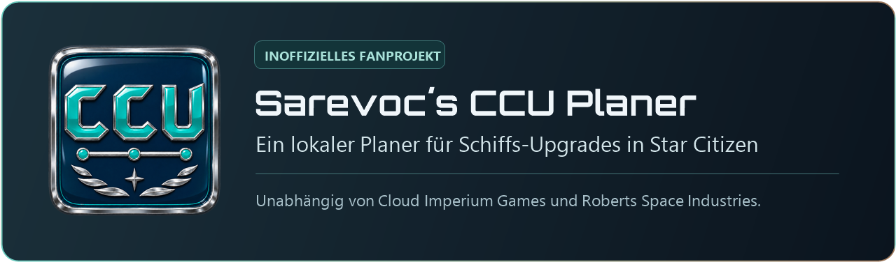

# Sarevoc´s CCU Planer

[Deutsch](#deutsch) | [English](#english)

## Deutsch

### Beschreibung

Sarevoc´s CCU Planer ist ein unabhängiges Fanprogramm für Star Citizen auf Windows 11. Du kannst deinen Hangarbestand mit Schiffen, Fahrzeugen, CCUs und Spielzugängen einsehen und Upgrade-Ketten planen. **0.3.75 Alpha** ist die aktuelle öffentliche Testversion und kostenlos verfügbar.

[Installer und Prüfsumme](https://github.com/Nitrolaus/Sarevocs-CCU-Planer/releases/tag/v0.3.75-alpha) | [Fehler melden](https://github.com/Nitrolaus/Sarevocs-CCU-Planer/issues/new?template=fehler.yml)

#### Bestand und Angebote

Im Bestand siehst du Store Credits am Profil, das RSI-Datum an den CCUs und den Hersteller des aktuellen Schiffsmodells. Angaben zu Loanern und Beibooten stammen aus öffentlichen Regeln. Du kannst sie per Rechtsklick für dein Profil als vorhanden oder nicht vorhanden bestätigen und die Bestätigung zurücksetzen. Deine Angabe erscheint mit Datum. Ob ein Loaner verfügbar ist, prüfst du im Spiel.

Der Planer lädt die öffentlichen Angebotsdaten beim Start und täglich um **17:05 Uhr in der Zeitzone Europe/Berlin**. Die Oberfläche ist auf Deutsch und Englisch verfügbar. Du kannst zwischen Euro und US-Dollar wählen und deinen Mehrwertsteuersatz einstellen.

#### CCU-Ketten planen

Für jede Kette wählst du selbst eine belegte LTI-Startbasis. Günstige Tokens bis etwa 50 Euro vor Steuer erscheinen zuerst. Höherwertige eigene LTI-Schiffe kannst du gezielt einblenden. Zielkarten und Kette stehen über den Angeboten. Die Karten und der Flottenplan verwenden neutrale Schiffssilhouetten.

Die Kettenvorschau vergleicht strukturierte CCUs aus deinem Hangar mit den noch offenen Lücken. Türkis kennzeichnet den Bestand, Orange die offenen Käufe. Das aktuell ausgewählte Ziel hat einen türkisen Rahmen. Ungeprüfte Übergänge sind entsprechend markiert. Der Vorrat erscheint standardmäßig in fünf Spalten. Du kannst Karten ziehen, Varianten vergleichen und Änderungen rückgängig machen. Entwürfe und gesperrte CCUs werden pro Profil gespeichert. Das rote Schloss zeigt an, dass ein Exemplar bei der Berechnung ausgeschlossen ist.

Der Konfliktberater berücksichtigt gemeinsam benötigte Exemplare. Ziel 1 hat Vorrang vor Ziel 2 und Ziel 2 vor Ziel 3. Du kannst die vorgeschlagenen Änderungen gemeinsam übernehmen. Der Kaufoptimierer vergleicht die Gesamtkosten verschiedener Einstiege. Bei beiden Beratern bleiben die begonnene Kette und ihre Kosten sichtbar.

Der Windows-Installer lässt dich den Programmordner wählen. Der Planer läuft in einer Instanz und ist über den Infobereich der Taskleiste erreichbar. Unter **Bestand** findest du eine Demo mit synthetischen Daten.

### Über mich

Hallo, ich bin Sarevoc. Auf GitHub findest du mich als Nitrolaus. Ich habe den Planer für meine eigenen CCU-Ketten gebaut und teile ihn kostenlos mit der Star-Citizen-Community. Ein weiteres Projekt von mir ist **Joystick Guardian**, ein Windows-Werkzeug für Joysticks und andere Eingabegeräte. Viel Spaß beim Planen! Wenn dir beim Testen etwas auffällt, freue ich mich über eine Rückmeldung. [Mein GitHub-Profil](https://github.com/Nitrolaus) | [Sarevoc auf Ko-fi unterstützen](https://ko-fi.com/sarevoc)

### Sicherheitskonzept

Der Planer ruft deinen Hangarbestand direkt bei RSI ab. Einkäufe und Änderungen am Bestand erledigst du selbst auf der offiziellen Seite. Passwort und MFA gibst du direkt bei RSI ein. Wenn du „Angemeldet bleiben“ wählst, speichert der Planer die wiederverwendbaren Sitzungscookies mit Windows-Verschlüsselung und getrennt vom Bestand. Unter „Sitzung & Sicherheit“ kannst du die gespeicherte Sitzung löschen.

Dein Bestand, deine Profile und deine Entwürfe bleiben auf deinem Rechner. Der Planer bietet keine Funktion, die diese Daten an mich oder einen Projektserver überträgt. Wenn du eine Datei exportierst, entscheidest du, ob du sie weitergibst. Im öffentlichen Quellcode kannst du nachlesen, welche Daten der Planer verarbeitet und wohin seine Anfragen gehen. [Quellcode](src/) | [Datenschutz und Datenflüsse](docs/public/DATENSCHUTZ.md)

Für konkrete Upgrade-Preise erhält RSI die öffentlichen Katalogkennungen der abgefragten Schiffspaare und, falls nötig, die Angebotskennung. Diese Abfrage nutzt eine getrennte Verbindung ohne Anmeldecookies.

### Was Alpha und die Internetmarkierung bedeuten

GitHub kennzeichnet diese Version als **Pre-release**, weil sie zum öffentlichen Testen gedacht ist. Funktionen und Bedienung können sich bis zur stabilen Version ändern. [GitHub zu Vorabversionen](https://docs.github.com/en/repositories/releasing-projects-on-github/managing-releases-in-a-repository)

Beim Download kann Windows die Internetherkunft der Datei kennzeichnen. Diese Herkunftsmarkierung heißt **Mark of the Web**. Da der Alpha-Installer noch keine digitale Signatur hat, kann Windows beim Start einen SmartScreen-Hinweis anzeigen. [Microsoft zur Internetmarkierung](https://support.microsoft.com/en-us/windows/security/information-about-the-attachment-manager-in-microsoft-windows) | [Microsoft zu SmartScreen](https://learn.microsoft.com/windows/apps/package-and-deploy/smartscreen-reputation)

### Offizieller Download

Ich veröffentliche den offiziellen Installer ausschließlich hier auf GitHub unter **Nitrolaus/Sarevocs-CCU-Planer**. Downloads auf anderen Seiten werden von den jeweiligen Anbietern bereitgestellt. Die `SHA256.txt` zur jeweiligen Version hilft dir zu prüfen, ob deine Datei mit meinem GitHub-Download übereinstimmt. [Offizielle Downloads](https://github.com/Nitrolaus/Sarevocs-CCU-Planer/releases)

### Ausblick

Ich möchte Schiffsgrafiken ergänzen, sobald sie für die Verwendung im Planer freigegeben sind. Außerdem möchte ich wichtige Termine rund um Star Citizen und die Messen im Planer sichtbar machen.

Wenn du dir eine Funktion wünschst oder etwas umständlich findest, schreib mir gern. Was zum Planer passt und was ich umsetzen kann, nehme ich auf. [Idee oder Feedback teilen](https://github.com/Nitrolaus/Sarevocs-CCU-Planer/issues)

### Lizenz

Für den Quellcode gilt eine [eigene Source-available-Lizenz mit Namenspflicht](LICENSE). Sie erlaubt Änderungen und kostenlose Weitergabe. Veröffentlichte Fassungen tragen den Namen **Sarevoc´s CCU Planer** und den Urhebervermerk **Sarevoc**. Bearbeitete Fassungen werden als **Geänderte Fassung** gekennzeichnet.

[Kettenbau](docs/public/KETTENBAUER.md) | [Kaufberatung](docs/public/BERATER.md) | [Datenherkunft](docs/public/PROFILDATEN.md) | [Loaner](docs/public/LOANER.md) | [Alpha testen](docs/public/TESTEN.md) | [Entwicklung](docs/public/ENTWICKLUNG.md) | [Datenschutz](docs/public/DATENSCHUTZ.md) | [Fremdkomponenten](THIRD_PARTY_NOTICES.md)

## English

### Description

Sarevoc´s CCU Planer is an independent Star Citizen fan project for Windows 11. Use it to review the ships, vehicles, CCUs, and game access in your hangar and plan ship upgrade chains. **0.3.75 Alpha** is the current public test release and is available free of charge.

[Installer and checksum](https://github.com/Nitrolaus/Sarevocs-CCU-Planer/releases/tag/v0.3.75-alpha) | [Report a bug](https://github.com/Nitrolaus/Sarevocs-CCU-Planer/issues/new?template=bug-report.yml)

#### Inventory and offers

The inventory shows Store Credits next to your profile, the RSI date on CCUs, and the manufacturer of each current ship model. Loaner and snub craft suggestions come from published rules. Right click a row to mark it as present or absent for your profile or clear your confirmation. Your confirmation includes the date. Check actual loaner availability in Star Citizen.

The planner fetches public offers at startup and daily at **17:05 in the Europe/Berlin time zone**. The app is available in German and English. You can choose euros or US dollars and set the VAT rate.

#### Plan CCU chains

Choose a verified LTI starting ship for each chain. Tokens worth up to roughly €50 before tax appear first. You can reveal higher value LTI ships that you own. The target cards and chain sit above the offers. The cards and fleet planner use neutral ship silhouettes.

The chain preview compares the CCUs read from your hangar with the gaps you still need to fill. Turquoise marks owned upgrades, and orange marks purchases still needed. A turquoise border highlights the selected target. Unverified steps are marked in the chain. The inventory grid uses five columns by default. You can drag cards into place, compare alternatives, and undo edits. Drafts and CCU locks are stored per profile. A red lock excludes that copy from calculations.

The conflict advisor checks which chains need the same CCU copy. Target 1 takes priority over target 2, which takes priority over target 3. You can apply the proposed changes together. The purchase advisor compares the total cost of different starting upgrades. The current chain and its costs stay visible in both views.

The Windows installer lets you choose where to install the app. The planner runs as a single instance and is available from the system tray. A demo with synthetic data is available under **Inventory**.

### About me

Hi, I’m Sarevoc. You’ll find me on GitHub as Nitrolaus. I built the planner for my own CCU chains and share it free of charge with the Star Citizen community. I also work on **Joystick Guardian**, a Windows tool for joysticks and other input devices. Enjoy planning, and feel free to tell me how the alpha works for you. [My GitHub profile](https://github.com/Nitrolaus) | [Support Sarevoc on Ko-fi](https://ko-fi.com/sarevoc)

### Security and privacy

The planner retrieves your hangar inventory directly from RSI. You make purchases and inventory changes yourself on the official site. Enter your password and MFA code directly on RSI. If you choose to stay signed in, the planner protects reusable session cookies with Windows encryption and keeps them separate from the inventory. You can delete the saved session under **Session & security**.

Your inventory, profiles, and drafts stay on your computer. The planner has no feature that uploads them to me or to a project server. If you export a file, you decide whether to share it. You can review the public source code to see which data the planner processes and where its requests go. [Source code](src/) | [Privacy notes in German](docs/public/DATENSCHUTZ.md)

For specific upgrade prices, RSI receives the public catalogue IDs for the requested ship pairs and the offer ID when needed. These requests use a separate connection without sign-in cookies.

### What Alpha and the download marking mean

GitHub labels this version **Pre-release** because it is intended for public testing. Features and workflows may change before the stable release. [GitHub on prereleases](https://docs.github.com/en/repositories/releasing-projects-on-github/managing-releases-in-a-repository)

Windows can mark a downloaded file as coming from the internet. This is called **Mark of the Web**. The alpha installer is unsigned, so Windows may show a SmartScreen warning when you run it. [Microsoft on download markings](https://support.microsoft.com/en-us/windows/security/information-about-the-attachment-manager-in-microsoft-windows) | [Microsoft on SmartScreen](https://learn.microsoft.com/windows/apps/package-and-deploy/smartscreen-reputation)

### Official download

I publish the official installer exclusively here on GitHub under **Nitrolaus/Sarevocs-CCU-Planer**. Downloads on other sites are provided by their respective operators. Compare your file’s SHA-256 checksum with the value in `SHA256.txt` from the same release to check that it matches my GitHub download. [Official downloads](https://github.com/Nitrolaus/Sarevocs-CCU-Planer/releases)

### What’s planned

I’d like to add ship artwork once it’s approved for use in the planner. I also want to show important dates for Star Citizen and its in-game expos in the app.

If you’d like a feature or find something awkward to use, I’d like to hear about it. I’ll implement suggestions that fit the planner when I can. [Share an idea or feedback](https://github.com/Nitrolaus/Sarevocs-CCU-Planer/issues)

### License

The code is released under a [custom source-available license with a naming requirement](LICENSE). It allows modification and free redistribution. Distributed versions must retain the name **Sarevoc´s CCU Planer** and the **Sarevoc** copyright notice. Modified versions must be clearly marked **Modified version**.

[Alpha testing guide in German](docs/public/TESTEN.md) | [Privacy notes in German](docs/public/DATENSCHUTZ.md) | [Third party notices](THIRD_PARTY_NOTICES.md)

[Official Star Citizen website](https://robertsspaceindustries.com/)
